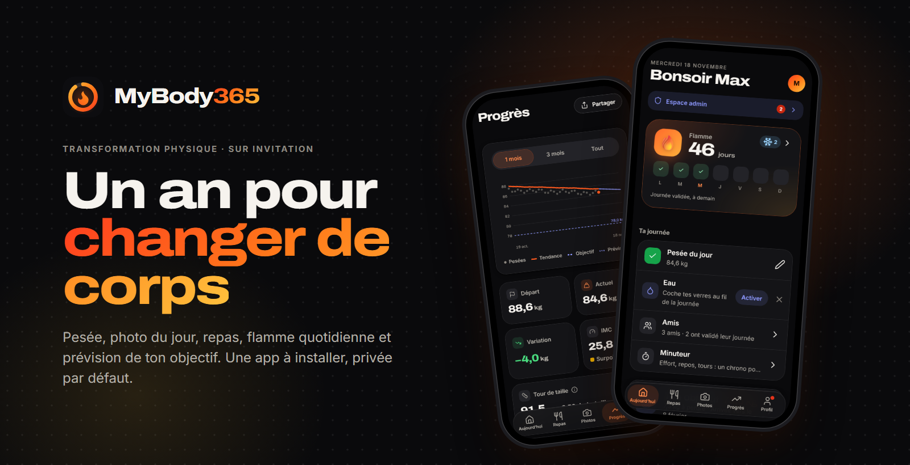
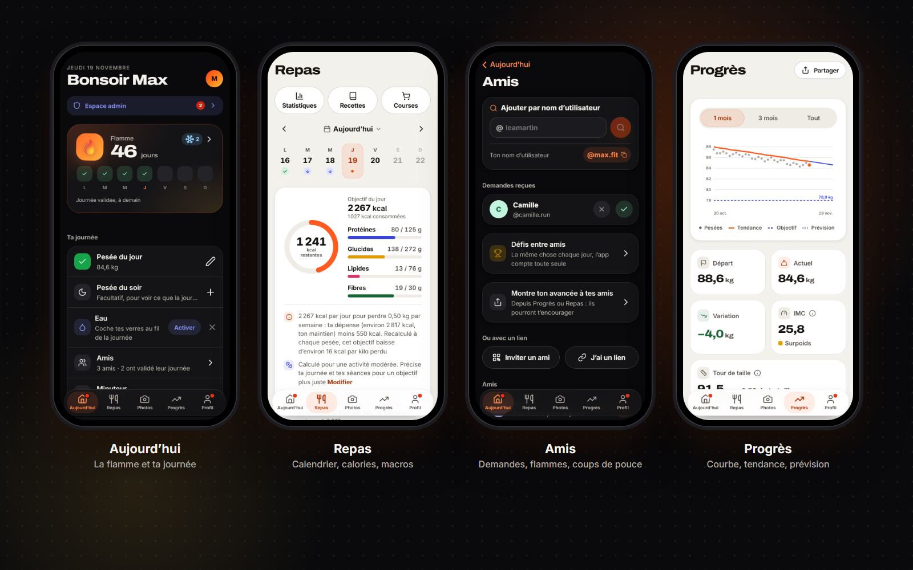
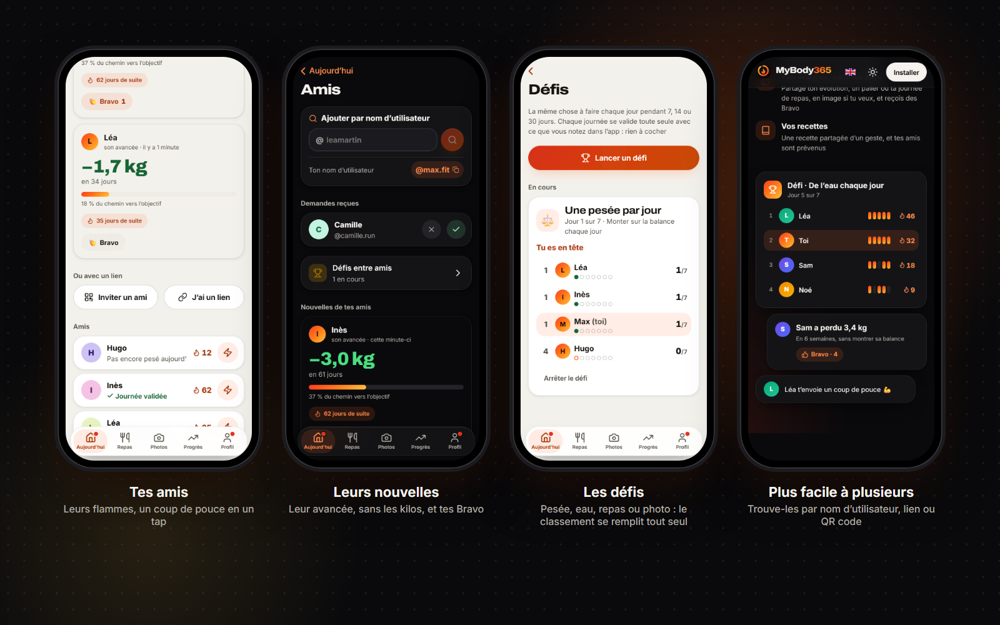
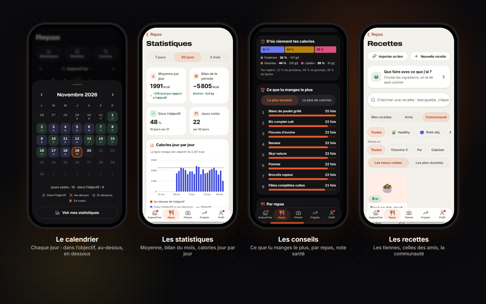

<p align="center">
  
</p>

<h1 align="center">MyBody365</h1>

<p align="center">
  <b>365 jours pour transformer ton corps.</b><br>
  Une pesée, une photo, tes repas : quelques secondes par jour, et une app qui te montre le chemin parcouru<br>
  et le jour où tu atteindras ton objectif.
</p>

<p align="center">
  <a href="https://mybody365.mbonnici.fr"><b>Découvrir et installer</b></a> ·
  <a href="https://mybody365.mbonnici.fr/changelog">Nouveautés</a> ·
  <a href="#déploiement">Héberger</a>
</p>

<p align="center">
  
  
  
  
  
  
  
</p>

---

## Une année, jour après jour

On ne transforme pas son corps en trois semaines. MyBody365 est pensé pour tenir **un an** : un rituel du matin qui prend moins d'une minute, une flamme qu'on n'a pas envie d'éteindre, des amis qui avancent avec toi, et des photos qui finissent par raconter une vraie histoire.

<p align="center">
  
</p>

| | |
|---|---|
| ⚖️ **Poids et prévision** | Ta courbe lissée, ta tendance réelle, la prévision mois par mois et la date de ton objectif, à un rythme sûr (1 % du poids par semaine au plus), et le calcul en calories (kilos × 7 700 ÷ ton déficit du jour) |
| 📸 **Photo du jour** | Un comparateur avant / après, puis le time-lapse de ton année |
| 👥 **Entre amis** | Ajoute-les par nom d'utilisateur, lien ou QR code : vos flammes côte à côte, des défis (pesée, eau, repas, photo) avec un classement qui se remplit tout seul, ton avancée partagée sans tes kilos et leurs Bravo, des coups de pouce, une photo partagée quand tu le décides |
| 🍽️ **Repas en trois taps** | Code-barres (Open Food Facts, copie locale), aliments du quotidien (Ciqual), repas au snack et boissons de tous les jours estimés en deux touches, note santé sur 10, vitamines et minéraux de ta journée |
| 📅 **Calendrier et statistiques** | Chaque jour marqué dans l'objectif, au-dessus ou en dessous, une note d'équilibre sur 10, les tendances de la semaine (trop de sucre ? pas assez de fibres ?) et un bilan clair du mois avec des conseils |
| 📖 **Recettes** | Les tiennes, celles de tes amis, la communauté, et l'import depuis un site de recettes en collant le lien : ingrédients reconnus, calories et note santé calculées |
| 🔥 **La flamme** | Chaque jour validé fait grandir ta série. Tous les 7 jours, un gel qui sauve un jour oublié. Une flamme, un bras musclé, une fusée… et la couleur de ton choix |
| 🔔 **Rappels** | Une notification à l'heure de ton choix, seulement s'il te manque ta pesée ou ta photo, un rappel pour la photo du jour à son heure, un rappel pour boire si tu le veux, le bilan du dimanche, et la pastille sur l'icône |
| 🏅 **Mes paliers** | Des étapes de ton choix vers ton objectif, avec une récompense si tu veux, fêtées à la pesée qui les passe |
| ⏱️ **Minuteur** | Effort, repos, tours : un chrono simple pour ta séance, tes chronos enregistrés, bips, vibrations et écran allumé. Il continue sur les autres écrans, écran verrouillé et derrière une autre app, avec une notification à chaque série |
| 💧 **Verres d'eau** | Facultatif : un verre à cocher, un objectif selon ton poids, à activer depuis l'écran Aujourd'hui |
| 💾 **Tes données à toi** | Sauvegarde complète en un tap, chaque nuit sur ton Google Drive, restauration avec aperçu |

> Version **1.16.0** : une app qui démarre déjà chargée (les cinq onglets et ce qu'ils affichent se chargent pendant l'écran du logo, et revenir sur un onglet ne recharge plus rien), la retouche des photos déjà prises (placer, rendre toute petite sur un fond flou, noir ou blanc, tourner, redresser, lumière et couleurs), les sushis à la pièce avec la sauce soja salée ou sucrée, et le poids de départ corrigé jusque dans ta courbe. La 1.15 : des verres d'eau plus grands qui se vident d'un double appui, un écran de démarrage avec le logo, les vitamines des aliments que Ciqual laisse vides estimées d'après un aliment proche, un conseil pour manger en volume. La 1.14.1 : les dépendances de sécurité à jour (PostgreSQL 18.7 et ses 52 failles corrigées, Node 24.22.3, Java 25.0.5, nginx 1.30, Spring Boot 4.1.3, Angular 22.3), la langue de ton téléphone tant que tu n'en choisis pas une, les vitamines sur la fiche des recettes et sur le site. La 1.14 : les vitamines et les minéraux de tes repas (et une alerte quand l'un manque depuis plusieurs jours), une recherche de recettes qui comprend chaque mot (« salade tiramisu chocolat »), le tri des recettes par vitamine, la note santé de chaque aliment de ta journée et de chaque ingrédient, « Voir la recette » depuis un repas, le calcul de ton objectif en calories, le poids de départ modifiable, une croix pour effacer les recherches, une page Recettes pour les admins, la section « Entre amis » du site et 56 nouvelles photos de recettes. La 1.13 : une note santé sur 10 à la place du Nutri-Score (ultra-transformés, friture, édulcorants et qualité des graisses comptés), des alertes sur les graisses saturées, le sucre et le sel, « Bon à savoir » sur la page Repas, les boissons au verre, les produits distingués par leur marque, leur contenance et leur catégorie, une recherche qui met les plus populaires en premier, 200 recettes Healthy, une barre d'onglets qui s'efface au défilement comme sur YouTube et une page Statistiques pour les admins. La 1.12 : une photo devant chaque aliment de tes repas, ce que chaque aliment t'apporte avec les barres de ta journée, la photo et la date de mise à jour des produits scannés, une note du jour qui dit à quoi elle sert et comment gagner des points, des points rouges sur les onglets où quelque chose t'attend, et des notifications bloquées par erreur qui se réactivent pas à pas. La 1.11 : liste de courses par rayon, « Que faire avec ce que j'ai ? », photos des recettes de la communauté. La 1.10 : recettes en double évitées, 529 recettes dans la communauté. La 1.7 : l'activité en deux questions (ta journée, tes séances) pour un objectif calorique plus juste, des repères en grammes expliqués et une répartition au choix, les tendances de la semaine (sucre, sel, fibres, protéines), les séances notées. La 1.6 : recettes importées d'un lien avec leurs calories (ingrédients reconnus dans Ciqual), boissons de tous les jours, amis prévenus des nouvelles recettes, profil rangé. La 1.5 : Nutri-Score des repas au snack, caméra au bon cadrage, tiroirs au doigt. La 1.4 : repas au snack estimés en deux touches, Open Food Facts gardé sur notre serveur. La 1.3 : navigation et retour au doigt à la façon de l'iPhone, IMC idéal pour ton âge, tour de taille et masse grasse pour ne pas confondre muscle et graisse, mises à jour silencieuses. La 1.2 : écrire au créateur depuis l'app, pastilles pour ce qui reste à faire, journal des erreurs pour les admins. La 1.1 : pastille sur l'icône, notification à chaque nouvelle version, rappels pour boire, IMC et objectif de calories expliqués. Le détail version par version est dans le [changelog](CHANGELOG.md).

## L'app

Pensée **uniquement pour le téléphone** : barre d'onglets flottante, écrans qui s'empilent et se dépilent comme dans une app native, retour par balayage depuis le bord, thème qui bascule dans un cercle qui s'ouvre depuis le bouton, français et anglais.

<p align="center">
  
</p>

### Plus facile à plusieurs

Tes amis te trouvent par ton nom d'utilisateur, un lien ou un QR code. Vous voyez vos flammes côte à côte, et un coup de pouce part en un tap le jour où celle d'un ami vacille. Lance un défi sur une semaine (la pesée, l'eau, les repas ou la photo chaque jour) : le classement se remplit tout seul avec ce que chacun note. Partage ton avancée sans montrer tes kilos, un palier passé ou ta journée de repas, en image si tu veux, et reçois leurs « Bravo ». Ce que tu montres, c'est toi qui le choisis, ami par ami et photo par photo.

<p align="center">
  
</p>

### Tes repas, enfin lisibles

Un coup d'œil à la semaine suffit : chaque jour porte une icône, coche verte dans l'objectif, flèche orange au-dessus, flèche bleue en dessous. Le calendrier du mois s'ouvre en touchant la date, et les statistiques répondent aux vraies questions : combien en moyenne, quel bilan ce mois-ci, qu'est-ce que je mange le plus, quel repas pèse le plus lourd. Puis quelques conseils concrets, tirés de tes propres repas.

<p align="center">
  
</p>

- **Un plan dès la première minute** : quatre questions (toi, ta taille et ton poids, ton objectif, ton rythme ou ta date d'arrivée), puis un objectif calorique calculé avec Mifflin-St Jeor, un plancher de sécurité, un rythme limité à 1 % du poids par semaine et une date d'arrivée estimée
- **Une pesée par jour** : boutons − / + à garder appuyés ou clavier numérique, mensurations facultatives, une pesée du soir si tu veux (dès 17 h, après celle du matin), et la flamme qui grandit
- **Une courbe honnête** : la tendance lissée gomme les variations d'eau, la prévision se recalcule sur tes quatre dernières semaines, et « Le calcul de ton objectif » traduit ce qui reste en calories (kilos × 7 700 ÷ ton déficit du jour = le nombre de jours). Le poids de départ se corrige à tout moment
- **La photo du jour** : caméra plein écran (celle de derrière par défaut) avec le calque de ta dernière photo (même cadrage chaque jour) et un retardateur si tu en veux un (retenu sur ton téléphone), ou une photo de ta galerie, une retouche des photos déjà prises (cadrage, taille jusqu'en tout petit sur un fond flou, noir ou blanc, rotation, luminosité, contraste et couleurs), qui s'ouvrent en grandissant depuis leur vignette, comparateur avant / après à faire glisser, time-lapse de l'année exportable en vidéo, les photos qui défilent au doigt, et un bouton pour tout flouter quand tu n'es pas seul
- **Repas en trois taps** : une seule recherche dans tout à la fois (les aliments bruts de la table Ciqual de l'Anses, les recettes, les produits industriels d'Open Food Facts), une page par source qui dit de quand datent ses données, scan du code-barres avec la photo du produit et la date de sa fiche, une petite photo devant chaque aliment, ce que chacun t'apporte avec les barres de ta journée, favoris, quantité au gramme, à la portion ou au verre pour les boissons (tasse, verre, mug, bol, canette), produits distingués par leur marque, leur catégorie et leur contenance, note santé sur 10 avec ses raisons et ses alertes (graisses saturées, sucre, sel), « Riche en » vitamine C, fer, calcium…, les plus populaires d'abord, « Comme hier », et même sans réseau (la saisie part au retour du réseau)
- **Tes calories, étape par étape** : ta dépense au repos avec ton poids, ta taille, ton âge et ton sexe, multipliée par ton activité et tes séances de sport de la semaine, puis ton rythme : l'objectif du jour expliqué avec tes propres chiffres
- **Un objectif qui apprend** : après quelques semaines de repas et de pesées, ta dépense réelle remplace l'estimation si tu le veux, et la note d'équilibre dit à quoi elle sert, ne juge la journée en cours que sur la qualité de ce que tu as mangé (le reste attend la fin de la journée, en vue) et donne un conseil pour gagner des points
- **Fast-food et restaurant** : raccourcis burger, kebab, pizza, tacos, nuggets, tenders, wings et poulet frit à la pièce, sushis par sorte (maki, california, nigiri, sashimi…) avec leur sauce soja à la cuillère… et « Tu n'as pas trouvé ? », un ajout rapide avec juste le nom et les calories, qui revient dans tes récents
- **Décris ton repas** : « 200 g de poulet, du riz et une pomme », écrit ou dicté, et chaque aliment de la table Ciqual est retrouvé avec son poids tel qu'il se mange (le riz cuit, la viande grillée, la portion d'une assiette quand rien n'est dit), à vérifier avant d'ajouter
- **Mon planning** : les repas de cette semaine et de la suivante prévus à l'avance (une recette pour ses parts, un repas habituel, une note), notés en un appui le jour venu, même sans réseau, et envoyés sur la liste de courses en un appui
- **Sucres ajoutés** : les tables ne donnent que le total, l'app estime les sucres libres de l'OMS (ajoutés, miel, sirops, jus) d'après ce qu'est chaque aliment, pour la note de la journée, les tendances et les statistiques
- **Mes repas habituels** : un repas de la journée gardé sous un nom revient en un appui, avec les mêmes aliments et les mêmes quantités, même sans réseau
- **Pâtisseries et chocolats** : viennoiseries, pâtisseries de la vitrine, petits gâteaux, chocolats (carrés, amandes au chocolat, rochers, truffes, orangettes…) et confiseries, à la pièce, à la part, au carré ou à la cuillère, d'après la table Ciqual et avec leur note santé. Et sur la pizza, l'huile pimentée à la cuillère
- **Le sandwich à composer** : le pain et sa taille, puis ce qu'il y a dedans portion par portion (jambon, poulet, thon, œuf, raclette, emmental, crudités, sauces…) ou n'importe quel aliment brut au gramme, des classiques pour partir (jambon-beurre, raclette, club, bagel saumon…), et sa note santé
- **Boissons de tous les jours** : café de l'expresso au latte, thé, infusion, matcha, chocolat chaud, avec le lait de ton choix (dont avoine, soja, amande), le sucre et les extras, notés sur le barème santé des boissons (l'eau comme référence)
- **L'apéro** : bière, vin, bulles, cocktails, alcool fort sec ou avec un soda, cidre et mocktails, au verre près, l'alcool compté en verres standard avec le repère de Santé publique France
- **Calendrier et statistiques** : la semaine avec une icône par jour, le mois en un tap, et sur 7 jours, 30 jours ou 3 mois la moyenne, le bilan en kilos, d'où viennent tes calories, ce que tu manges le plus, la note santé de ton assiette et des conseils, et « Bon à savoir » (graisses saturées et mauvais cholestérol, sucre, sel, ultra-transformés, fibres, eau, fruits, vitamines, 1 kg de graisse ≈ 7 700 kcal)
- **Vitamines et minéraux** : la note de la journée montre ce que tes aliments t'apportent en vitamines A, D, E, C, B1, B2, B6, B9 et B12, calcium, fer, magnésium, potassium et zinc, en part du repère européen des étiquettes (table Ciqual, et Open Food Facts quand le produit les donne). Quand l'un manque depuis plusieurs jours, une alerte le dit avec les aliments qui en apportent. Une valeur absente des tables n'est jamais comptée comme un manque
- **Recettes** : ingrédients pesés et calories calculées pour toi, ou importées depuis un site de recettes en collant le lien (ou en partageant la page vers l'app sur Android) : chaque ingrédient est reconnu dans la table Ciqual avec son poids, et les recettes de [Les créations de Yona](https://les-creations-de-yona.fr/) arrivent avec leur photo. Trois niveaux de partage : toi, tes amis (d'un geste depuis la recette, prévenus par une notification, ou envoyée à un ami en particulier : la notification l'ouvre dans son app, sur iPhone aussi), la communauté, publiée par l'équipe (736 recettes calculées avec Ciqual : 200 recettes Healthy en premier, les plats préférés et ceux de tous les jours, les plats légers, les cuisines du monde et des régions, la pâtisserie de « Plaisir », les cocktails et mocktails), que chacun cherche, note, copie et garde en favori, avec leur photo libre de Wikimedia Commons créditée (658 sur 736). Chaque part dit son poids une fois cuite (« 412 kcal la part · ≈ 380 g »), estimé d'après les ingrédients (les pâtes et le riz gonflent, la viande perd de l'eau, les sauces réduisent), et se choisit aussi au poids de l'assiette. La recherche comprend chaque mot à part (« salade tiramisu chocolat » trouve les salades, les tiramisus et les recettes au chocolat), et les recettes se trient par vitamine ou minéral. Chaque recette faite d'aliments a sa note santé, qui compte la part de fruits, de légumes, de légumineuses et de fruits à coque. Avant d'en créer une (ou un aliment), l'app propose celles qui lui ressemblent déjà
- **Cuisiner pas à pas** : les étapes une par une en grand, l'écran qui reste allumé, un minuteur en un appui pour chaque durée écrite dans une étape
- **Que faire avec ce que j'ai ?** : jusqu'à 6 ingrédients sous la main, et les recettes qui les utilisent, celles où il manque le moins de choses d'abord
- **Liste de courses** : les ingrédients des recettes pour le nombre de parts voulu, additionnés et rangés dans l'ordre des rayons du supermarché (les surgelés à la fin), tes propres articles, cochés au fil du panier et partageables
- **Amis** : un nom d'utilisateur unique pour te trouver, demandes d'ami, invitation par QR code ou lien, flammes des amis, coups de pouce, photo partagée une par une avec qui tu veux, ton avancée ou ta journée de repas partagées (ou envoyées en image), les « Bravo » de tes amis, des défis entre amis (pesée, eau, repas ou photo chaque jour, classement qui se remplit tout seul), tes paliers partagés, et leurs photos de profil en grand d'un tap
- **Santé, en option** : la tension du matin et du soir (la moyenne de 1 à 3 mesures, sa courbe à côté de celle du poids, les seuils de l'automesure) et un pilulier (tes traitements, leurs heures, la case à cocher et un rappel qui ne nomme jamais le médicament sur l'écran verrouillé). Éteints tant que tu ne les allumes pas
- **Le bilan du mois** : raconté comme une story (les kilos et leur courbe, la plus longue série, les repas et la note santé, l'eau, la première et la dernière photo), puis une image à partager sans photo du corps
- **Partager avec un pro de santé** : un lien en lecture seule pour un coach ou un diététicien, avec ce que tu choisis (pesées, repas, tension, jamais les photos), 7 ou 30 jours, révocable, chaque ouverture comptée, la page s'imprime
- **Relevé pour ton médecin** : la règle des 3 de l'automesure tensionnelle (3 jours, matin et soir, 3 mesures), les moyennes face au seuil de 135/85 et les traitements, à imprimer ou enregistrer en PDF
- **Centre des notifications** : la cloche sur Aujourd'hui garde toutes les notifications reçues pendant 90 jours, les nouvelles marquées, 20 par page, et les défis entre amis te rappellent chaque soir une journée pas encore faite
- **Même sans réseau** : l'écran de démarrage le dit (« Pas de connexion internet · Accès en mode hors ligne »), puis l'app s'ouvre sur tes écrans tels que la dernière fois (ta journée, tes repas, tes photos, tes progrès), jamais sur l'écran de connexion. Un repas, une pesée, un verre d'eau, une photo, une case cochée restent en gris avec « Sera envoyé plus tard », puis partent d'eux-mêmes quand le réseau revient. La pastille dit depuis quand tu es hors ligne, et le centre des notifications garde l'heure de chaque coupure et de chaque retour du réseau
- **Comme une app de téléphone** : écrans qui glissent les uns sur les autres et retour d'un glissement depuis le bord, titre qui passe en petit dans la barre du haut en faisant défiler, tirer vers le bas pour actualiser, l'onglet touché de nouveau qui remonte en haut, lignes qui s'éclairent sous le doigt, retours haptiques
- **Ton profil** : photo de profil (vue par tes amis seulement, l'initiale sinon), nom d'utilisateur, et des pages à part pour les verres d'eau, l'apparence et la langue
- **Sauvegardes** : un fichier avec toutes tes données et photos, Google Drive chaque nuit, restauration qui montre d'abord ce qui change
- **Connexion sans mot de passe** : Google ou passkey (Face ID, empreinte, code du téléphone)
- **Sur invitation** : on demande un accès depuis l'écran de connexion, un administrateur valide et envoie un lien d'invitation valable 24 h
- **Accès perdu ?** Un lien de récupération à usage unique permet d'ajouter une passkey ou de relier un autre compte Google
- **Administration dans l'app** : comptes, rôles et quotas de stockage, demandes d'accès, liens actifs révocables, mise à jour de la table Ciqual en un bouton (Open Food Facts se met à jour tout seul), statistiques du serveur (stockage, mémoire, processeur et leurs courbes sur 24 h), les recettes de la communauté à modifier (nom, ingrédients, étapes, photo), masquer ou remettre, modération des signalements, journal de toutes les actions des admins

## Le site

Pas de « texte à gauche, capture à droite ». En haut de la page, le chiffre **365** et un exemple de série : les journées validées en vert, les jours gelés en glaçon, la flamme sur aujourd'hui. On comprend la promesse en une seconde, et le bouton dit simplement **Installer l'application**.

Juste après, **l'aperçu** : de vraies captures de l'app, en clair ou en sombre selon ton thème, à faire glisser du doigt avant même d'installer quoi que ce soit. Puis **Entre amis** : les flammes côte à côte, un défi et son classement, une avancée partagée qui reçoit des Bravo.

Le parcours suit ensuite les étapes clés, du jour 0 (l'installation) au jour 365, avec des vignettes qui se manipulent : un avant / après à faire glisser du doigt, l'année entière à lancer en lecture, un cadenas pour la vie privée. Les animations suivent le défilement, sans bibliothèque, et respectent le réglage « réduire les animations ».

<p align="center">
  
</p>

## Privé par défaut

- **Tes photos ne sont visibles que par toi.** Même les administrateurs ne les voient pas, sauf une photo partagée qui leur a été signalée, le temps de traiter le signalement. Tu choisis, photo par photo, ce que tu partages avec un ami
- **Chaque photo est redessinée** par le serveur et enregistrée en WebP : aucune donnée cachée du fichier d'origine ne survit, pas même la position GPS. La photo de profil aussi, et l'ancienne est effacée quand tu la changes
- **On ne te trouve que si on connaît ton nom d'utilisateur exact** : pas d'annuaire, pas de suggestion
- **Tes amis voient ta flamme, pas ta balance** : prénom, nombre de jours, journée validée. Le reste, seulement si tu le partages : ton avancée (sans tes kilos, sauf si tu le demandes) ou une journée de repas, pendant 30 jours, sans rien sur leur écran verrouillé
- **Aucune pub, aucun traceur, aucune revente.** Deux cookies, strictement nécessaires : la session et la protection CSRF
- **Hébergé en France**, réservé aux personnes majeures, données de santé traitées avec un consentement explicite (RGPD art. 9)
- Les polices sont servies par le site lui-même : pas une requête vers Google Fonts. Open Food Facts est interrogé par le serveur, jamais par ton téléphone
- **Google Drive avec la permission la plus restreinte** : l'app ne voit que les fichiers qu'elle crée

## Qualité

| | Résultat |
|---|---|
| Lighthouse 13, pages publiques (mobile, réseau bridé, processeur ralenti 4×, revu en 1.12) | Accessibilité **100** · Bonnes pratiques **100** · SEO **100** · Performance **86 à 99** selon les pages et les passages (LCP de 0,8 à 1,2 s, aucun décalage de mise en page) |
| Tests back (JUnit + Testcontainers, avec un vrai SeaweedFS) | 164 tests : planning de la semaine (repas notés, liste de courses, une recette supprimée l'emporte), sucres ajoutés d'une journée (la pomme ne compte pas), règles des sucres libres, nems au four pas « frits », recette envoyée à un ami (amis seulement, recette qu'ils peuvent ouvrir, une fois en 10 minutes), repas décrit en mots retrouvé cuit avec ses poids, repas habituels, bilan d'un mois, lien pour un coach ouvert sans compte puis retiré, heure habituelle des rappels, poids d'une part cuite (pâtes et riz qui gonflent, viande qui perd de l'eau, sauce qui réduit), 736 recettes de la communauté, photo retouchée qui prend la place de l'ancienne avec ses partages, pesée du premier jour corrigée avec le poids de départ, accès et rôles (dont le compte « Bot » que personne ne modifie ni ne supprime), langue de l'appareil tant qu'aucune n'est choisie, vitamines et minéraux des repas et des recettes (une valeur absente des tables n'est jamais un manque), recettes de la communauté modifiées par un admin seulement, recherche mot par mot et tri par vitamine, poids de départ modifiable, CSRF, en-têtes, limitation de débit, calculs (dont l'activité en deux questions), répartition des macros, sources de sucre et de sel, flamme et gels, photos (réencodage, quotas, confidentialité), Ciqual et Open Food Facts simulés, copie locale d'Open Food Facts (export simulé), photo et date des produits (chemin d'image vérifié, seules de vraies images renvoyées), contenance, catégorie, transformation et édulcorants des produits lus dans l'export, note santé sur 10 (les mêmes aliments repères que l'app), boissons en millilitres, repas, ajout rapide, calendrier et statistiques, recettes et visibilité, import de recettes (sites simulés dont Les créations de Yona, adresses privées refusées, ingrédients reconnus dans Ciqual), annonce des nouvelles recettes aux amis, communauté publiée par les admins seulement, 729 recettes de départ dont 200 Healthy (fichiers vérifiés, ajoutées une seule fois), recettes qui se ressemblent, liste de courses par rayon, « avec ce que j’ai », aliments qui existent déjà, photos de la communauté (une seule fois, créditées), rappel de la photo du jour, « Plaisir », favoris, recette partagée d'un geste, avancée, journée et palier partagés aux amis seulement et leurs « Bravo », défis entre amis (jours lus dans les données, amis seulement, cinq au plus), pesée du soir, sources des aliments, recherche dans la communauté, Nutri-Score des recettes (part de fruits et de légumes), chiffrement Web Push, alertes du minuteur écran verrouillé, rappels du jour et de l'eau, annonce des nouvelles versions, messages au créateur, journal des erreurs, pastilles, amis, noms d'utilisateur, suggestions et demandes, photo de profil (jamais la même adresse deux fois, photos Google effacées), verres d'eau, chronos enregistrés, rythme limité, partages, signalements, sauvegardes et fichiers piégés |
| Tests front (Vitest) | 103 tests : nouvelle version annoncée sur l'onglet Profil, prévision mois par mois arrêtée au jour donné par le serveur, nems au four pas « frits », textes de l'app chargés à part, repères de l'OMS des tendances et leurs sources, lien de recette reconnu dans une recherche, minuteurs lus dans les étapes d'une recette, plateau du poids, réponses gardées sur le téléphone sans réseau et journal des coupures, pâtisseries et chocolats, sushis à la pièce et sauces soja du poké bowl, filtres de la retouche identiques à l'aperçu, traductions complètes FR / EN, note santé sur 10 (aliments repères, raisons dites seulement quand elles sont vraies, alertes, recettes et repas), noms de la liste de courses, plateformes, passkeys, erreurs, navigation, calendrier des repas, note d'équilibre (critères de fin de journée, conseil pour gagner des points), dessins des aliments, prévision mois par mois, noms d'utilisateur, tranches d'IMC, IMC idéal, tour de taille et masse grasse, estimations fast-food, boissons et apéro (verres standard, pas de note pour l'alcool), et leur note santé, repères en grammes et répartitions, tendances de la semaine, Nutri-Score des recettes (part de fruits et de légumes), saisies sans réseau, minuteur sur l'horloge réelle (écran verrouillé, app fermée par le système) |
| Tests de bout en bout (Playwright + axe-core) | 87 tests, aussi lancés dans le moteur de Safari : le démarrage sans réseau annoncé sous le logo, un ingrédient de recette scanné sans perdre la recette en cours, le rythme réel à côté du calcul de l'objectif avec la même date partout, une semaine prévue, mangée et envoyée sur la liste de courses, une photo ouverte en zoom puis refermée, « Annuler » après un retrait, l'eau à côté de la flamme, une pesée supprimée après la question de l'app, les sources des repères, une recette envoyée puis son lien ouvert dans un navigateur et collé dans la recherche, un repas décrit puis gardé et rajouté en un appui, une ligne de repas glissée vers la gauche pour la dupliquer puis la retirer, le bilan du mois, le relevé pour le médecin, la cuisine pas à pas, le lien d'un coach ouvert dans un autre navigateur, l'app relancée sans réseau sur ce qu'elle montrait, la coupure et le retour du réseau dans le centre des notifications, l'huile pimentée de la pizza et les chocolats, retouche d'une photo (taille, fond blanc, rotation, luminosité), retour sur un onglet sans nouvelle requête, sushis à la pièce, pesée du départ corrigée ou gardée, un navigateur en anglais reçoit le site et l'app en anglais, recherche de recettes mot par mot avec sa croix et le tri par vitamine, « Voir la recette » depuis un repas, calcul de l'objectif en calories et poids de départ, page Recettes de l'administration, barre d'onglets qui s'efface au défilement, boisson au verre avec sa note santé et « Bon à savoir », recettes Healthy en premier, statistiques du serveur, site, installation, connexion, admin (dont les données des aliments), parcours de bienvenue, pesée, IMC expliqué, photos (dont depuis la galerie), recettes qui se ressemblent, liste de courses et « avec ce que j’ai », aliment qui existe déjà, rappel photo, repas, ajout rapide, calendrier et statistiques, recettes et recherche dans toutes les recettes, flamme, réglages des notifications, minuteur (qui continue ailleurs), verres d'eau à toucher, photos floutées, photo de profil en grand, avancée partagée et « Bravo » d'un ami, défi entre deux amis, recette ajoutée depuis un repas, photos qui défilent, pesée du soir, pages Produits industriels et Aliments bruts, apéro, retours et erreurs côté admin, amis par lien et par nom d'utilisateur, photo de profil, partage et modération, sauvegarde et restauration, accessibilité, débordements mobile |
| Sécurité | CSP stricte (`script-src 'self'` + deux empreintes), CSRF, cookie de session HttpOnly / SameSite / Secure, limitation par IP, journal admin. Rapport complet : [docs/security-audit.md](docs/security-audit.md) |
| Sessions | Gardées en base (Spring Session JDBC) : une nouvelle version déployée ne déconnecte personne, et un compte suspendu est coupé tout de suite |

## Stack technique

```
Cloudflare ─► Traefik (Coolify, TLS) ─► nginx (app Angular + proxy /api) ─► Spring Boot ─┬► PostgreSQL
                                                                                          └► SeaweedFS (S3)
```

- **Front** : Angular 22 (signals, zoneless), service worker (une nouvelle version s'installe toute seule quand l'app passe en arrière-plan, ou tout de suite avec « Recharger » dans le Profil), pages publiques prérendues au build, nginx non root
- **Back** : Spring Boot 4.1 / Java 25, Spring Security 7 (OAuth2 Google + WebAuthn), Spring Session JDBC, Flyway
- **Base** : PostgreSQL 18 ; photos, photos de profil et images de recettes sur SeaweedFS (S3), en WebP grâce à cwebp, 2 Go par compte par défaut
- **Notifications** : Web Push standard (chiffrement RFC 8291, signature VAPID), sans service tiers ni SDK
- **Données** : Open Food Facts (copie locale des produits vendus en France, mise à jour toute seule chaque mois ou depuis l'administration ; appel direct en secours pour un code-barres tout neuf) et la table Ciqual de l'Anses (importée depuis data.gouv.fr)
- **Design** : système maison (Archivo + Inter, accent « flamme »), icônes d'après Lucide, aucun framework CSS

## Déploiement

Le dépôt se déploie tel quel sur [Coolify](https://coolify.io) (Docker Compose).

1. **Google Cloud Console** › API et services › Identifiants › ID client OAuth (application Web)
   - Origine JavaScript autorisée : `https://mybody365.mbonnici.fr`
   - URI de redirection autorisées : `https://mybody365.mbonnici.fr/api/auth/oauth2/code/google` et, pour les sauvegardes, `https://mybody365.mbonnici.fr/api/me/drive/callback`
   - Pour les sauvegardes Google Drive : activer **Google Drive API** dans la bibliothèque d'API et ajouter la portée `.../auth/drive.file` à l'écran de consentement (portée non sensible : pas de validation Google à demander)
2. **Coolify** : ressource *Docker Compose* sur ce dépôt, domaine sur le service **frontend**, port **8080**
3. **Variables obligatoires** (le déploiement s'arrête si l'une manque) :

   | Variable | Rôle |
   |---|---|
   | `GOOGLE_CLIENT_ID` / `GOOGLE_CLIENT_SECRET` | Client OAuth Google |
   | `ADMIN_EMAILS` | Adresses Google toujours administrateurs, séparées par `;` |

   `SERVICE_USER_POSTGRES`, `SERVICE_PASSWORD_64_POSTGRES`, `SERVICE_USER_S3` et `SERVICE_PASSWORD_64_S3` sont générées par Coolify. Facultatives : `STORAGE_QUOTA_MB` (stockage par compte en Mo, 2048 soit 2 Go par défaut) et `OFF_USER_AGENT`. Détails dans [.env.example](.env.example).
4. **Après le premier déploiement** : dans l'app, Profil › Administration › Aliments › **Mettre à jour Ciqual** (téléchargement d'environ 70 Mo, suivi en direct). Les clés des notifications (VAPID) se créent toutes seules au premier démarrage.

## Développer

Prérequis : Docker Desktop et Node 24. Java n'est pas nécessaire, le back se compile dans Docker.

```bash
docker compose -f docker-compose.local.yml up --build -d --wait
# site : http://localhost:4300   ·   app dans un onglet : http://localhost:4300/app?browser=1
```

L'app ne s'ouvre normalement qu'installée ; `?browser=1` lève cette restriction sur `localhost` uniquement, et les boutons « Connexion locale » permettent d'entrer sans Google.

```bash
cd frontend
npm test                         # tests unitaires
npx playwright install chromium
npm run e2e                      # bout en bout + accessibilité (stack locale démarrée)
E2E_PORT=4300 npm run e2e:iphone # les mêmes sur Safari (WebKit, iPhone 15), dans l'image Linux de Playwright
```

Tests du back (PostgreSQL lancé par Testcontainers) :

```bash
cd backend
docker run --rm -v "$PWD:/app" -v "$HOME/.m2:/root/.m2" -v /var/run/docker.sock:/var/run/docker.sock \
  -e TESTCONTAINERS_HOST_OVERRIDE=host.docker.internal -w /app eclipse-temurin:25.0.5_8-jdk-alpine \
  sh -c "apk add --no-cache libwebp-tools && ./mvnw -B test"
```

Les tests du back lancent PostgreSQL et SeaweedFS ; Open Food Facts, l'entrepôt Ciqual, les sites de recettes, Wikimedia Commons et les services de notification sont simulés : aucun test ne sort de la machine.

Les images de ce README et les captures de l'aperçu du site (`frontend/public/shots`) se régénèrent avec `frontend/scripts/screenshots.mjs` (le mode d'emploi est en tête du fichier).

## Feuille de route

| Version | Contenu | État |
|---|---|---|
| 0.1 | Socle : site, installation, comptes Google et passkeys, invitations, récupération, administration, pages légales | ✅ |
| 0.2 | Suivi : parcours de bienvenue, plan calorique, pesée et mensurations, flamme, courbe, tendance et prévision, objectif | ✅ |
| 0.3 | Photos : photo du jour (stockage S3, WebP, quotas), comparateur avant / après, time-lapse | ✅ |
| 0.4 | Repas : Open Food Facts, Ciqual, aliments perso, recettes, Nutri-Score, recettes de la communauté | ✅ |
| 0.5 | Engagement : gels de flamme, notifications quotidiennes, rappels salle, programmes | ✅ |
| 0.6 | Amis : ajout par lien ou QR code, partage photo par photo, coups de pouce, modération | ✅ |
| 0.7 | Sauvegardes : Google Drive automatique, export, restauration avec aperçu des différences | ✅ |
| 1.0 | Repas lisibles : note d'équilibre, calendrier, statistiques et conseils, ajout rapide fast-food, import de recettes, recettes entre amis, Nutri-Score en avant, noms d'utilisateur, photo de profil, minuteur, verres d'eau, date d'arrivée et prévision mois par mois | ✅ |
| 1.1 | Retours iPhone : barre d'onglets, zoom, pastille sur l'icône, nouvelles versions annoncées, rappels pour boire, IMC et calories expliqués | ✅ |
| 1.2 | Écrire au créateur, pastilles, journal des erreurs, retour au doigt comme sur iPhone | ✅ |
| 1.3 | Navigation façon iPhone, IMC idéal, mises à jour silencieuses | ✅ |
| 1.4 | Repas au snack estimés, Open Food Facts en local | ✅ |
| 1.5 | Nutri-Score des repas au snack, caméra et tiroirs corrigés | ✅ |
| 1.6 | Import de recettes calculé, boissons de tous les jours, nouvelles recettes annoncées aux amis, profil rangé | ✅ |
| 1.7 | Activité en deux questions, repères en grammes et répartition au choix, tendances de la semaine | ✅ |
| 1.8 | Paliers vers l'objectif, flamme à ton image, recettes qui gardent leurs filtres | ✅ |
| 1.9 | Recherche dans tout, produits industriels et aliments bruts, favoris, apéro, « Plaisir » et 129 recettes du quotidien, partages et défis entre amis, pesée du soir, verres d'eau et vibrations | ✅ |
| 1.10 | Recettes qui se ressemblent repérées avant d'en créer une, 200 recettes de plus (léger, monde, régions, matin, boissons), photo du jour depuis la galerie, retardateur retenu, pesée du soir toujours visible | ✅ |
| 1.11 | Liste de courses par rayon, « Que faire avec ce que j'ai ? », photos des recettes de la communauté (Wikimedia Commons), aliments qui existent déjà repérés, rappel de la photo du jour | ✅ |
| 1.12 | Photos des aliments dans les repas, ce que chaque aliment apporte, photo et date des produits scannés, note du jour expliquée, points rouges sur les onglets, notifications réactivées pas à pas, 465 recettes de la communauté en photo | ✅ |
| 1.14 | Vitamines et minéraux des repas et alertes de manque, recherche de recettes mot par mot et tri par vitamine, note santé de chaque aliment et ingrédient, calcul de l'objectif en calories, poids de départ modifiable, page Recettes pour les admins, compte « Bot », section Entre amis du site, photos Open Food Facts gardées sur le serveur | ✅ |
| 1.13 | Note santé sur 10 à la place du Nutri-Score, alertes graisses saturées, sucre et sel, « Bon à savoir », boissons au verre, produits distingués par marque, catégorie et contenance, recherche par popularité, 200 recettes Healthy et 137 nouvelles photos, barre d'onglets qui s'efface au défilement, statistiques du serveur, Open Food Facts mis à jour tout seul | ✅ |
| 1.15 | Verres d'eau plus grands à vider d'un double appui, écran de démarrage, vitamines estimées d'après un aliment proche, conseil « manger en volume » | ✅ |
| 1.16 | App chargée dès le démarrage et onglets qui ne rechargent plus, retouche des photos, sushis à la pièce et sauce soja, poids de départ corrigé dans la courbe | ✅ |
| 1.17 | Saisies sans réseau en gris puis envoyées, centre des notifications, tension et pilulier en option, sandwich à composer, sushis par sorte, calcul des calories expliqué | ✅ |
| 1.18 | App qui s'ouvre sans réseau sur ce qu'elle montrait, heure des coupures et des retours du réseau, pâtisseries et chocolats, poids d'une part de recette, titre compact, tirer pour actualiser, pesée du jour mise en avant, page Repas réordonnée | ✅ |
| 1.19 | Repas décrit en quelques mots, repas habituels, bilan du mois en story, lien en lecture seule pour un coach, relevé de tension pour le médecin, cuisine pas à pas, rappels à l'heure habituelle, carte « plateau », raccourcis de l'icône, ligne de repas glissée pour la dupliquer ou la retirer, recette envoyée à un ami, sources des repères (OMS, Anses), eau à côté de la flamme, confirmations dans une fenêtre de l'app | ✅ |
| 1.20 | Planning des repas de la semaine vers la liste de courses, sucres ajoutés estimés, photo qui s'ouvre en zoom, « Annuler » après un retrait, « frit » d'après les ingrédients, appui des boutons sans faux départs, app plus légère au démarrage, scan des ingrédients d'une recette, rythme réel à côté du calcul de l'objectif, écran de démarrage centré qui annonce l'absence de réseau, nouvelle version à recharger depuis le Profil | ✅ |

Le détail de chaque version est dans le [changelog](CHANGELOG.md), aussi publié sur le site.

## Crédits

Un projet de [Maxence Bonnici](https://mbonnici.fr), tous droits réservés : le code est visible pour être consulté, mais toute copie, réutilisation ou exploitation demande son accord écrit ([licence](LICENSE)). Polices Inter et Archivo (SIL OFL 1.1), icônes d'après Lucide (ISC), lecture des codes-barres avec ZXing (Apache 2.0), QR codes avec node-qrcode (MIT). Données : [Open Food Facts](https://world.openfoodfacts.org) (ODbL) et la table [Ciqual](https://ciqual.anses.fr) de l'Anses (Licence Ouverte 2.0). Voir [THIRD_PARTY_NOTICES.md](THIRD_PARTY_NOTICES.md). Mentions légales, confidentialité et conditions d'utilisation sur [le site](https://mybody365.mbonnici.fr/legal/mentions).
