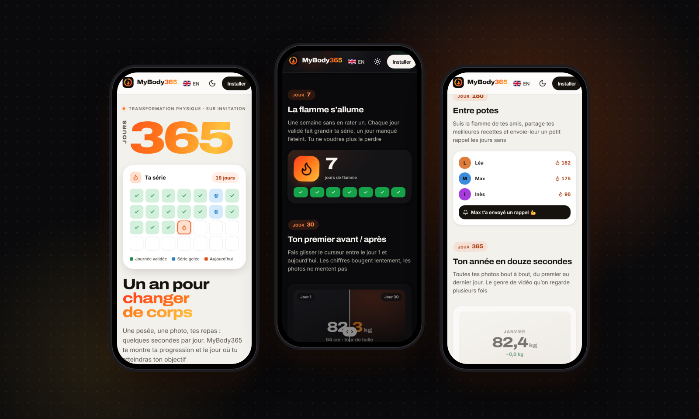
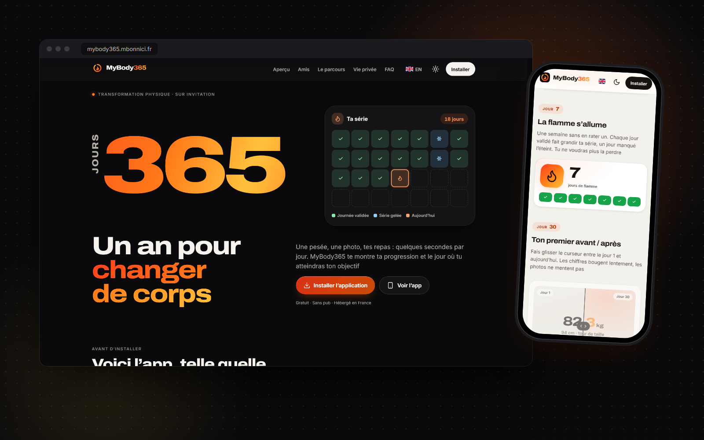

<p align="center">
  
</p>

<h1 align="center">MyBody365</h1>

<p align="center">
  <b>365 jours pour transformer ton corps.</b><br>
  Une pesée, une photo, tes repas : quelques secondes par jour, et une app qui te montre le chemin parcouru<br>
  et le jour où tu atteindras ton objectif.
</p>

<p align="center">
  <a href="https://mybody365.mbonnici.fr"><b>Découvrir et installer</b></a> ·
  <a href="https://mybody365.mbonnici.fr/changelog">Nouveautés</a> ·
  <a href="#déploiement">Héberger</a>
</p>

<p align="center">
  
  
  
  
  
  
  
</p>

---

## Une année, jour après jour

On ne transforme pas son corps en trois semaines. MyBody365 est pensé pour tenir **un an** : un rituel du matin qui prend moins d'une minute, une flamme qu'on n'a pas envie d'éteindre, des amis qui avancent avec toi, et des photos qui finissent par raconter une vraie histoire.

<p align="center">
  
</p>

| | |
|---|---|
| ⚖️ **Poids et prévision** | Ta courbe lissée, ta tendance réelle, la prévision mois par mois et la date de ton objectif, à un rythme sûr (1 % du poids par semaine au plus) |
| 📸 **Photo du jour** | Un comparateur avant / après, puis le time-lapse de ton année |
| 🍽️ **Repas en trois taps** | Code-barres (Open Food Facts, copie locale), aliments du quotidien (Ciqual), repas au snack et boissons de tous les jours estimés en deux touches, Nutri-Score |
| 📅 **Calendrier et statistiques** | Chaque jour marqué dans l'objectif, au-dessus ou en dessous, une note d'équilibre sur 10 et un bilan clair du mois avec des conseils |
| 📖 **Recettes** | Les tiennes, celles de tes amis, la communauté, et l'import depuis un site de recettes en collant le lien : ingrédients reconnus, calories et Nutri-Score calculés |
| 🔥 **La flamme** | Chaque jour validé fait grandir ta série. Tous les 7 jours, un gel qui sauve un jour oublié |
| 🔔 **Rappels** | Une notification à l'heure de ton choix, seulement s'il te manque ta pesée ou ta photo, un rappel pour boire si tu le veux, et la pastille sur l'icône |
| ⏱️ **Minuteur** | Effort, repos, tours : un chrono simple pour ta séance, tes chronos enregistrés, bips, vibrations et écran allumé |
| 💧 **Verres d'eau** | Facultatif : un verre à cocher, un objectif selon ton poids, à activer depuis l'écran Aujourd'hui |
| 👥 **Entre potes** | Retrouve-les par nom d'utilisateur, suivez vos flammes, des coups de pouce, une photo partagée quand tu le décides |
| 💾 **Tes données à toi** | Sauvegarde complète en un tap, chaque nuit sur ton Google Drive, restauration avec aperçu |

> Version **1.6.0** : recettes importées d'un lien avec leurs calories (ingrédients reconnus dans Ciqual), boissons de tous les jours, amis prévenus des nouvelles recettes, profil rangé. La 1.5 : Nutri-Score des repas au snack, caméra au bon cadrage, tiroirs au doigt. La 1.4 : repas au snack estimés en deux touches, Open Food Facts gardé sur notre serveur. La 1.3 : navigation et retour au doigt à la façon de l'iPhone, IMC idéal pour ton âge, tour de taille et masse grasse pour ne pas confondre muscle et graisse, mises à jour silencieuses. La 1.2 : écrire au créateur depuis l'app, pastilles pour ce qui reste à faire, journal des erreurs pour les admins. La 1.1 : pastille sur l'icône, notification à chaque nouvelle version, rappels pour boire, IMC et objectif de calories expliqués. Le détail version par version est dans le [changelog](CHANGELOG.md).

## L'app

Pensée **uniquement pour le téléphone** : barre d'onglets flottante, écrans qui s'empilent et se dépilent comme dans une app native, retour par balayage depuis le bord, thème qui bascule dans un cercle qui s'ouvre depuis le bouton, français et anglais.

<p align="center">
  
</p>

### Tes repas, enfin lisibles

Un coup d'œil à la semaine suffit : chaque jour porte une icône, coche verte dans l'objectif, flèche orange au-dessus, flèche bleue en dessous. Le calendrier du mois s'ouvre en touchant la date, et les statistiques répondent aux vraies questions : combien en moyenne, quel bilan ce mois-ci, qu'est-ce que je mange le plus, quel repas pèse le plus lourd. Puis quelques conseils concrets, tirés de tes propres repas.

<p align="center">
  
</p>

- **Un plan dès la première minute** : quatre questions (toi, ta taille et ton poids, ton objectif, ton rythme ou ta date d'arrivée), puis un objectif calorique calculé avec Mifflin-St Jeor, un plancher de sécurité, un rythme limité à 1 % du poids par semaine et une date d'arrivée estimée
- **Une pesée par jour** : boutons − / + à garder appuyés ou clavier numérique, mensurations facultatives, et la flamme qui grandit
- **Une courbe honnête** : la tendance lissée gomme les variations d'eau, la prévision se recalcule sur tes quatre dernières semaines
- **La photo du jour** : caméra plein écran avec le calque de ta dernière photo (même cadrage chaque jour) et un retardateur, comparateur avant / après à faire glisser, time-lapse de l'année exportable en vidéo
- **Repas en trois taps** : une seule recherche pour tes aliments, la table Ciqual de l'Anses et Open Food Facts, scan du code-barres, quantité au gramme ou à la portion, Nutri-Score, « Comme hier »
- **Fast-food et restaurant** : raccourcis burger, kebab, pizza, tacos… et un ajout rapide avec juste le nom et les calories, qui revient dans tes récents
- **Boissons de tous les jours** : café de l'expresso au latte, thé, infusion, matcha, chocolat chaud, avec le lait de ton choix (dont avoine, soja, amande), le sucre et les extras, notés sur le barème Nutri-Score des boissons
- **Calendrier et statistiques** : la semaine avec une icône par jour, le mois en un tap, et sur 7 jours, 30 jours ou 3 mois la moyenne, le bilan en kilos, d'où viennent tes calories, ce que tu manges le plus, le Nutri-Score de ton assiette et des conseils
- **Recettes** : ingrédients pesés et calories calculées pour toi, ou importées depuis un site de recettes en collant le lien (ou en partageant la page vers l'app sur Android) : chaque ingrédient est reconnu dans la table Ciqual avec son poids, et les recettes de [Les créations de Yona](https://les-creations-de-yona.fr/) arrivent avec leur photo. Trois niveaux de partage : toi, tes amis (prévenus par une notification), la communauté qui note et copie les meilleures
- **Amis** : un nom d'utilisateur unique pour te trouver, demandes d'ami, invitation par QR code ou lien, flammes des amis, coups de pouce, photo partagée une par une avec qui tu veux
- **Ton profil** : photo de profil (vue par tes amis seulement, l'initiale sinon), nom d'utilisateur, et des pages à part pour les verres d'eau, l'apparence et la langue
- **Sauvegardes** : un fichier avec toutes tes données et photos, Google Drive chaque nuit, restauration qui montre d'abord ce qui change
- **Connexion sans mot de passe** : Google ou passkey (Face ID, empreinte, code du téléphone)
- **Sur invitation** : on demande un accès depuis l'écran de connexion, un administrateur valide et envoie un lien d'invitation valable 24 h
- **Accès perdu ?** Un lien de récupération à usage unique permet d'ajouter une passkey ou de relier un autre compte Google
- **Administration dans l'app** : comptes, rôles et quotas de stockage, demandes d'accès, liens actifs révocables, mise à jour de la table Ciqual en un bouton, modération des signalements, journal de toutes les actions des admins

## Le site

Pas de « texte à gauche, capture à droite ». En haut de la page, le chiffre **365** et un exemple de série : les journées validées en vert, les jours gelés en glaçon, la flamme sur aujourd'hui. On comprend la promesse en une seconde, et le bouton dit simplement **Installer l'application**.

Juste après, **l'aperçu** : de vraies captures de l'app, en clair ou en sombre selon ton thème, à faire glisser du doigt avant même d'installer quoi que ce soit.

Le parcours suit ensuite les étapes clés, du jour 0 (l'installation) au jour 365, avec des vignettes qui se manipulent : un avant / après à faire glisser du doigt, l'année entière à lancer en lecture, un cadenas pour la vie privée. Les animations suivent le défilement, sans bibliothèque, et respectent le réglage « réduire les animations ».

<p align="center">
  
</p>

## Privé par défaut

- **Tes photos ne sont visibles que par toi.** Même les administrateurs ne les voient pas, sauf une photo partagée qui leur a été signalée, le temps de traiter le signalement. Tu choisis, photo par photo, ce que tu partages avec un ami
- **Chaque photo est redessinée** par le serveur et enregistrée en WebP : aucune donnée cachée du fichier d'origine ne survit, pas même la position GPS. La photo de profil aussi, et l'ancienne est effacée quand tu la changes
- **On ne te trouve que si on connaît ton nom d'utilisateur exact** : pas d'annuaire, pas de suggestion
- **Tes amis voient ta flamme, pas ta balance** : prénom, nombre de jours, journée validée. Rien d'autre
- **Aucune pub, aucun traceur, aucune revente.** Deux cookies, strictement nécessaires : la session et la protection CSRF
- **Hébergé en France**, réservé aux personnes majeures, données de santé traitées avec un consentement explicite (RGPD art. 9)
- Les polices sont servies par le site lui-même : pas une requête vers Google Fonts. Open Food Facts est interrogé par le serveur, jamais par ton téléphone
- **Google Drive avec la permission la plus restreinte** : l'app ne voit que les fichiers qu'elle crée

## Qualité

| | Résultat |
|---|---|
| Lighthouse, pages publiques (mobile, réseau bridé, processeur ralenti 4×) | Accessibilité **100** · Bonnes pratiques **100** · SEO **100** · Performance **72 à 85** selon les pages (LCP autour d'une seconde) |
| Tests back (JUnit + Testcontainers, avec un vrai SeaweedFS) | 86 tests : accès et rôles, CSRF, en-têtes, limitation de débit, calculs, flamme et gels, photos (réencodage, quotas, confidentialité), Ciqual et Open Food Facts simulés, copie locale d'Open Food Facts (export simulé), repas, ajout rapide, calendrier et statistiques, recettes et visibilité, import de recettes (sites simulés dont Les créations de Yona, adresses privées refusées, ingrédients reconnus dans Ciqual), annonce des nouvelles recettes aux amis, communauté, chiffrement Web Push, rappels du jour et de l'eau, annonce des nouvelles versions, messages au créateur, journal des erreurs, pastilles, amis, noms d'utilisateur, suggestions et demandes, photo de profil (jamais la même adresse deux fois, photos Google effacées), verres d'eau, chronos enregistrés, rythme limité, partages, signalements, sauvegardes et fichiers piégés |
| Tests front (Vitest) | 39 tests : traductions complètes FR / EN, plateformes, passkeys, erreurs, navigation, calendrier des repas, note d'équilibre, prévision mois par mois, noms d'utilisateur, tranches d'IMC, IMC idéal, tour de taille et masse grasse, estimations fast-food et boissons, et leur Nutri-Score |
| Tests de bout en bout (Playwright + axe-core) | 55 tests : site, installation, connexion, admin, parcours de bienvenue, pesée, IMC expliqué, photos, repas, ajout rapide, calendrier et statistiques, recettes, flamme, réglages des notifications, minuteur, verres d'eau, retours et erreurs côté admin, amis par lien et par nom d'utilisateur, photo de profil, partage et modération, sauvegarde et restauration, accessibilité, débordements mobile |
| Sécurité | CSP stricte (`script-src 'self'` + deux empreintes), CSRF, cookie de session HttpOnly / SameSite / Secure, limitation par IP, journal admin. Rapport complet : [docs/security-audit.md](docs/security-audit.md) |
| Sessions | Gardées en base (Spring Session JDBC) : une nouvelle version déployée ne déconnecte personne, et un compte suspendu est coupé tout de suite |

## Stack technique

```
Cloudflare ─► Traefik (Coolify, TLS) ─► nginx (app Angular + proxy /api) ─► Spring Boot ─┬► PostgreSQL
                                                                                          └► SeaweedFS (S3)
```

- **Front** : Angular 22 (signals, zoneless), service worker, pages publiques prérendues au build, nginx non root
- **Back** : Spring Boot 4.1 / Java 25, Spring Security 7 (OAuth2 Google + WebAuthn), Spring Session JDBC, Flyway
- **Base** : PostgreSQL 18 ; photos, photos de profil et images de recettes sur SeaweedFS (S3), en WebP grâce à cwebp, 2 Go par compte par défaut
- **Notifications** : Web Push standard (chiffrement RFC 8291, signature VAPID), sans service tiers ni SDK
- **Données** : Open Food Facts (copie locale des produits vendus en France, mise à jour depuis l'administration ; appel direct en secours pour un code-barres tout neuf) et la table Ciqual de l'Anses (importée depuis data.gouv.fr)
- **Design** : système maison (Archivo + Inter, accent « flamme »), icônes d'après Lucide, aucun framework CSS

## Déploiement

Le dépôt se déploie tel quel sur [Coolify](https://coolify.io) (Docker Compose).

1. **Google Cloud Console** › API et services › Identifiants › ID client OAuth (application Web)
   - Origine JavaScript autorisée : `https://mybody365.mbonnici.fr`
   - URI de redirection autorisées : `https://mybody365.mbonnici.fr/api/auth/oauth2/code/google` et, pour les sauvegardes, `https://mybody365.mbonnici.fr/api/me/drive/callback`
   - Pour les sauvegardes Google Drive : activer **Google Drive API** dans la bibliothèque d'API et ajouter la portée `.../auth/drive.file` à l'écran de consentement (portée non sensible : pas de validation Google à demander)
2. **Coolify** : ressource *Docker Compose* sur ce dépôt, domaine sur le service **frontend**, port **8080**
3. **Variables obligatoires** (le déploiement s'arrête si l'une manque) :

   | Variable | Rôle |
   |---|---|
   | `GOOGLE_CLIENT_ID` / `GOOGLE_CLIENT_SECRET` | Client OAuth Google |
   | `ADMIN_EMAILS` | Adresses Google toujours administrateurs, séparées par `;` |

   `SERVICE_USER_POSTGRES`, `SERVICE_PASSWORD_64_POSTGRES`, `SERVICE_USER_S3` et `SERVICE_PASSWORD_64_S3` sont générées par Coolify. Facultatives : `STORAGE_QUOTA_MB` (stockage par compte en Mo, 2048 soit 2 Go par défaut) et `OFF_USER_AGENT`. Détails dans [.env.example](.env.example).
4. **Après le premier déploiement** : dans l'app, Profil › Administration › Aliments › **Mettre à jour Ciqual** (téléchargement d'environ 70 Mo, suivi en direct). Les clés des notifications (VAPID) se créent toutes seules au premier démarrage.

## Développer

Prérequis : Docker Desktop et Node 24. Java n'est pas nécessaire, le back se compile dans Docker.

```bash
docker compose -f docker-compose.local.yml up --build -d --wait
# site : http://localhost:4300   ·   app dans un onglet : http://localhost:4300/app?browser=1
```

L'app ne s'ouvre normalement qu'installée ; `?browser=1` lève cette restriction sur `localhost` uniquement, et les boutons « Connexion locale » permettent d'entrer sans Google.

```bash
cd frontend
npm test                         # tests unitaires
npx playwright install chromium
npm run e2e                      # bout en bout + accessibilité (stack locale démarrée)
```

Tests du back (PostgreSQL lancé par Testcontainers) :

```bash
cd backend
docker run --rm -v "$PWD:/app" -v "$HOME/.m2:/root/.m2" -v /var/run/docker.sock:/var/run/docker.sock \
  -e TESTCONTAINERS_HOST_OVERRIDE=host.docker.internal -w /app eclipse-temurin:25-jdk-alpine \
  sh -c "apk add --no-cache libwebp-tools && ./mvnw -B test"
```

Les tests du back lancent PostgreSQL et SeaweedFS ; Open Food Facts, l'entrepôt Ciqual, les sites de recettes et les services de notification sont simulés : aucun test ne sort de la machine.

Les images de ce README et les captures de l'aperçu du site (`frontend/public/shots`) se régénèrent avec `frontend/scripts/screenshots.mjs` (le mode d'emploi est en tête du fichier).

## Feuille de route

| Version | Contenu | État |
|---|---|---|
| 0.1 | Socle : site, installation, comptes Google et passkeys, invitations, récupération, administration, pages légales | ✅ |
| 0.2 | Suivi : parcours de bienvenue, plan calorique, pesée et mensurations, flamme, courbe, tendance et prévision, objectif | ✅ |
| 0.3 | Photos : photo du jour (stockage S3, WebP, quotas), comparateur avant / après, time-lapse | ✅ |
| 0.4 | Repas : Open Food Facts, Ciqual, aliments perso, recettes, Nutri-Score, recettes de la communauté | ✅ |
| 0.5 | Engagement : gels de flamme, notifications quotidiennes, rappels salle, programmes | ✅ |
| 0.6 | Amis : ajout par lien ou QR code, partage photo par photo, coups de pouce, modération | ✅ |
| 0.7 | Sauvegardes : Google Drive automatique, export, restauration avec aperçu des différences | ✅ |
| 1.0 | Repas lisibles : note d'équilibre, calendrier, statistiques et conseils, ajout rapide fast-food, import de recettes, recettes entre amis, Nutri-Score en avant, noms d'utilisateur, photo de profil, minuteur, verres d'eau, date d'arrivée et prévision mois par mois | ✅ |
| 1.1 | Retours iPhone : barre d'onglets, zoom, pastille sur l'icône, nouvelles versions annoncées, rappels pour boire, IMC et calories expliqués | ✅ |
| 1.2 | Écrire au créateur, pastilles, journal des erreurs, retour au doigt comme sur iPhone | ✅ |
| 1.3 | Navigation façon iPhone, IMC idéal, mises à jour silencieuses | ✅ |
| 1.4 | Repas au snack estimés, Open Food Facts en local | ✅ |
| 1.5 | Nutri-Score des repas au snack, caméra et tiroirs corrigés | ✅ |
| 1.6 | Import de recettes calculé, boissons de tous les jours, nouvelles recettes annoncées aux amis, profil rangé | ✅ |

Le détail de chaque version est dans le [changelog](CHANGELOG.md), aussi publié sur le site.

## Crédits

Un projet de [Maxence Bonnici](https://mbonnici.fr), publié sous [licence MIT](LICENSE). Polices Inter et Archivo (SIL OFL 1.1), icônes d'après Lucide (ISC), lecture des codes-barres avec ZXing (Apache 2.0), QR codes avec node-qrcode (MIT). Données : [Open Food Facts](https://world.openfoodfacts.org) (ODbL) et la table [Ciqual](https://ciqual.anses.fr) de l'Anses (Licence Ouverte 2.0). Voir [THIRD_PARTY_NOTICES.md](THIRD_PARTY_NOTICES.md). Mentions légales, confidentialité et conditions d'utilisation sur [le site](https://mybody365.mbonnici.fr/legal/mentions).
